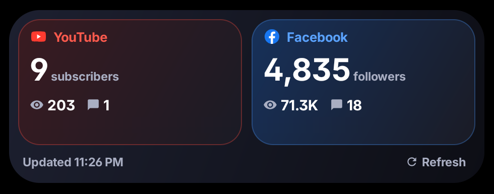
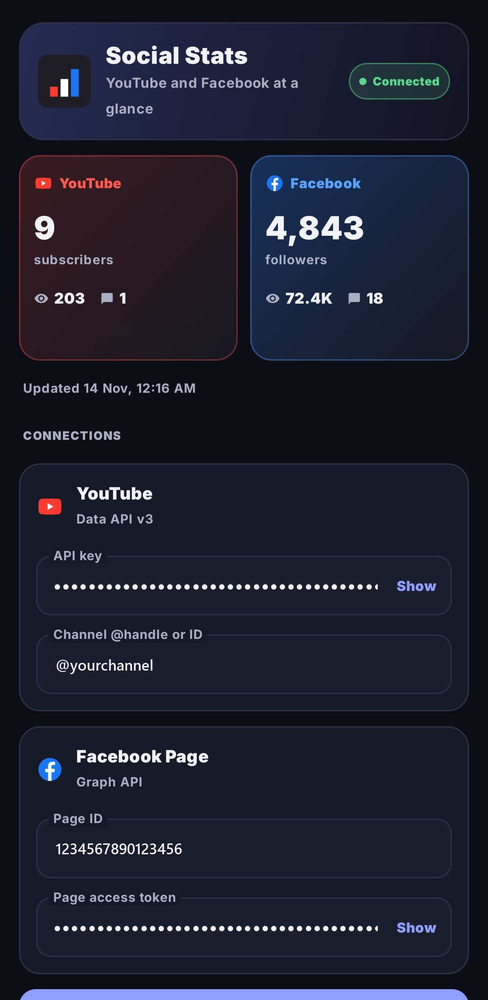
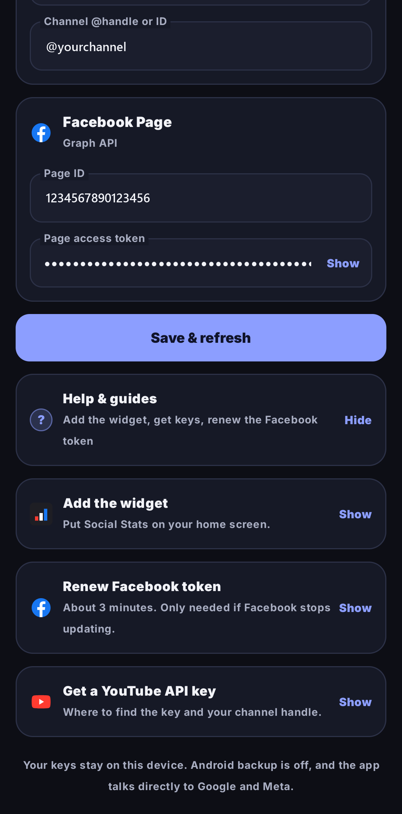

# Social Stats Widget — YouTube & Facebook Stats on Your Android Home Screen

<p align="center">
  
  
  
  
</p>

<p align="center"><b>A clean, lightweight home-screen widget that shows your YouTube and Facebook Page numbers at a glance — no dashboards, no logins, no ads.</b></p>

<p align="center">Subscribers • Followers • Last video views • Last video comments • Auto-refresh • Tap to open</p>

<p align="center">
  
</p>

---

## Table of Contents

- [About the Project](#about-the-project)
- [Why I Built It](#why-i-built-it)
- [Who Will Use It](#who-will-use-it)
- [Why They Will Use It](#why-they-will-use-it)
- [Key Features](#key-features)
- [Screenshots](#screenshots)
- [Tech Stack](#tech-stack)
- [Architecture Overview](#architecture-overview)
- [Getting Started](#getting-started)
- [Getting Your API Keys](#getting-your-api-keys)
- [Configuration](#configuration)
- [Permissions & Privacy](#permissions--privacy)
- [Known Limitations](#known-limitations)
- [Project Structure](#project-structure)
- [Roadmap](#roadmap)
- [Contributing](#contributing)
- [License](#license)
- [Author & Contact](#author--contact)

---

## About the Project

**Social Stats Widget** is a native Android app whose whole job is one home-screen widget. It pulls the numbers a creator checks all day and shows them in a single card:

- **YouTube:** subscribers, plus the views and comments of your latest video
- **Facebook Page:** followers, plus the views and comments of your latest video

It uses the official **YouTube Data API v3** and the **Facebook Graph API**. You type your own keys into the app once, and the widget keeps itself up to date.

Built with **Kotlin + Jetpack Compose (Material 3)** for the settings screen and **Jetpack Glance** for the widget, with **WorkManager** handling background refresh.

Package: `com.abir.socialwidget` • Min SDK 26 • Target SDK 36

---

## Why I Built It

I run a small content page, and I kept opening YouTube Studio and Meta Business Suite just to see three numbers. I wanted something I could glance at on my phone without opening anything.

1. **Too many taps for three numbers:** Studio and Business Suite are heavy apps. A widget answers the question instantly.
2. **No single view:** YouTube and Facebook each have their own dashboard. I wanted both side by side.
3. **Own your keys:** Many "analytics" apps want you to sign in with a third-party service. Here the keys stay on your device and the app talks directly to Google and Meta.
4. **Calm design:** A dark, glassy card that looks at home on any wallpaper, with clear icons instead of walls of text.
5. **Learning project:** A real-world exercise in Jetpack Glance, WorkManager, REST APIs with plain `HttpURLConnection`, and handling the awkward parts of the Meta Graph API (business-owned Pages, token lifetimes, permissions).

---

## Who Will Use It

- **Content creators** who post on both YouTube and Facebook and want a quick pulse check.
- **Page admins and social media managers** who check follower and view counts many times a day.
- **Small businesses** running a Facebook Page and a YouTube channel.
- **Developers** who want a compact, readable example of a Glance widget with background work and real APIs.

---

## Why They Will Use It

- **Everything in one glance:** subscribers, followers, last-video views and comments on the home screen.
- **No account on a third-party server:** the app calls Google and Meta directly. There is no backend, no analytics SDK and no ads.
- **Keys stay on the device:** stored in the app's private storage, with Android backup switched off so they are not copied to the cloud.
- **Tap to open, tap to refresh:** tapping the widget opens the app; a dedicated Refresh button updates it on demand.
- **Built-in guides:** the app contains step-by-step help, with links, for getting a YouTube API key and renewing a Facebook token.
- **Honest failure messages:** if Facebook rejects the token, the widget shows a short warning line, and the app shows a banner with a renewal guide.

---

## Key Features

### 1. Home-Screen Widget (4x2, resizable)
- Two cards: **YouTube** (red accent) and **Facebook** (blue accent) with brand icons
- Large subscriber and follower counts, formatted as `4,835`, `12.4K`, `1.2M`
- Last video: views (eye icon), comments (speech-bubble icon) and the video title
- "Updated 11:26 PM" in your local time, 12-hour format
- Gradient glass background that works on light and dark wallpapers
- Tap anywhere to open the app; tap **Refresh** to update now

### 2. Background Refresh
- Updates about every **15 minutes** using WorkManager (the shortest interval Android reliably allows)
- Runs only when the device is online
- A failure on one platform never blocks the other; the last good numbers stay on screen

### 3. YouTube Data
- Subscribers from the channel statistics
- Latest upload found through the channel's uploads playlist, then its views, comments and title
- Accepts a channel **@handle**, a channel ID, or a pasted channel URL
- Handles hidden subscriber counts gracefully

### 4. Facebook Page Data
- Followers from the Page's `followers_count` (falls back to `fan_count`)
- Latest video views and comment count (best effort, depends on Meta permissions)
- Works with Pages owned through a **Business portfolio**

### 5. App Screen
- **Header** with a status chip: *Connected*, *Setup needed* or *Attention*
- **Live stat tiles** that mirror the widget: subscribers / followers, last-video views and comments, last update time
- **Connections:** one card for YouTube (API key, channel) and one for the Facebook Page (Page ID, Page token). Secrets are masked, with a **Show / Hide** toggle
- **Save & refresh** button with a loading state
- **Warning cards** when YouTube or Facebook fails, with a shortcut that opens the matching guide
- One collapsible **Help & guides** section containing *Add the widget*, *Renew Facebook token* and *Get a YouTube API key*, each with numbered steps and buttons that open the right page
- Consistent dark design that matches the widget

---

## Screenshots

<p align="center">
  
  &nbsp;&nbsp;&nbsp;&nbsp;
  
</p>

<p align="center"><i>Live stat tiles and connections • Collapsible Help &amp; guides</i></p>

<p align="center"><sub>Channel handle and Page ID are example placeholders in these screenshots.</sub></p>

---

## Tech Stack

**Language & UI:**
- Kotlin 2.2.10, Jetpack Compose (BOM 2026.09.00), Material 3

**Widget:**
- Jetpack Glance (`glance-appwidget` and `glance-material3` 1.1.1), vector icons and shape drawables for the gradient cards

**Background work:**
- WorkManager 2.12.0 (periodic and one-time refresh)

**Networking & data:**
- `HttpURLConnection` + `org.json` (no Retrofit/OkHttp needed), YouTube Data API v3, Facebook Graph API v21.0
- `SharedPreferences` in private app storage for keys and the cached numbers

**Build:**
- Gradle 9.3.1, Android Gradle Plugin 9.1.1, Java 17, compileSdk 37

See `gradle/libs.versions.toml` and `app/build.gradle.kts` for exact versions.

---

## Architecture Overview

Small single-module app with a clear split between UI, data fetching and background work:

- `MainActivity.kt` — Compose settings screen, last-result view, error banner and the collapsible Help guides
- `StatsWidget.kt` — the Glance widget (`StatsWidget`), its receiver (`StatsWidgetReceiver`), the refresh action and the number formatter
- `Repo.kt` — fetches YouTube and Facebook independently, caches the result and redraws the widget
- `Store.kt` — settings and cached stats on top of `SharedPreferences`
- `Scheduler.kt` — `RefreshWorker` plus periodic (15 min) and one-time WorkManager scheduling

Data flow: **WorkManager / Refresh tap → `Repo.refreshAll()` → YouTube + Facebook APIs → `Store` → `StatsWidget.updateAll()`**.

---

## Getting Started

### Prerequisites

- [Android Studio](https://developer.android.com/studio) (current stable release recommended), or just JDK 17 and the Android SDK
- Android SDK Platform 37
- An Android device or emulator on Android 8.0 (API 26) or newer
- Your own API keys (free), see [Getting Your API Keys](#getting-your-api-keys)

### Run Locally

1. Clone the repo:
   ```bash
   git clone https://github.com/InfinityAbir/Social-Stats-Widget.git
   ```
2. Open the folder in Android Studio and let Gradle sync. Select **JDK 17** (the bundled JBR works) under **Settings > Build, Execution, Deployment > Build Tools > Gradle**.
3. Run the app on a device, or build from the terminal:
   ```bash
   ./gradlew assembleDebug
   ```
   On Windows use `gradlew.bat assembleDebug`. The APK is written to `app/build/outputs/apk/debug/app-debug.apk`.
4. Open **Social Stats**, enter your keys and tap **Save & refresh**.
5. Long-press the home screen, choose **Widgets**, and drag **Social Stats** onto it.

---

## Getting Your API Keys

The same steps are available inside the app under **Help**.

### YouTube (free)
1. Open [Google Cloud Console](https://console.cloud.google.com/) and create or select a project.
2. Enable **YouTube Data API v3** for it.
3. Go to **Credentials > Create credentials > API key**. Restrict the key to YouTube Data API v3 and leave application restrictions on **None**.
4. Use your channel **@handle** (shown on your channel page and in YouTube Studio) as the channel.

One refresh uses about 3 quota units; the free daily quota is 10,000.

### Facebook Page (free)
1. Create an app at [Meta for Developers](https://developers.facebook.com/apps/) using the **Manage everything on your Page** use case.
2. Open the [Graph API Explorer](https://developers.facebook.com/tools/explorer/), pick your app, choose **User Token**, add `pages_show_list`, `pages_read_engagement` (and `business_management` if your Page belongs to a Business portfolio), then **Generate Access Token** and approve your Page.
3. Extend the token in the [Access Token Debugger](https://developers.facebook.com/tools/debug/accesstoken/) with **Extend Access Token**.
4. Paste the long-lived token into the Explorer and run:
   ```
   me/accounts?fields=id,name,access_token
   ```
5. In the result, the Page `id` is your **Page ID** and its `access_token` is your **Page token**. Page tokens made from a long-lived user token do not expire under normal use.

Never commit or share these values. They exist only in the app on your device.

---

## Configuration

- **Channel:** `@handle`, channel ID (`UC...`) or a channel URL.
- **Refresh interval:** 15 minutes, set in `Scheduler.kt`. Android does not allow background work more often than this.
- **Graph API version:** set by `FB_VERSION` in `Repo.kt`.
- **Colors and shapes:** gradient backgrounds live in `res/drawable/` (`widget_bg.xml`, `card_yt.xml`, `card_fb.xml`); text colors are at the top of `StatsWidget.kt`.

---

## Permissions & Privacy

| Permission | Why |
|---|---|
| `INTERNET` | Call the YouTube and Facebook APIs |
| `ACCESS_NETWORK_STATE` | Let WorkManager run refreshes only when online |

- No ads, no analytics, no crash-reporting SDK, no backend.
- API keys and the cached numbers are stored in the app's private storage.
- Android backup is disabled (`allowBackup="false"`), so keys are not copied to cloud backups.
- Requests go straight from your device to Google and Meta.

---

## Known Limitations

- **YouTube subscriber counts** are rounded and slightly delayed by YouTube itself, so small channels may lag by a few minutes.
- **Facebook last-video views and comments** depend on Meta permissions for your Page. If Meta blocks them, followers still work and the video numbers show `—`.
- **Facebook tokens** can be invalidated, for example after a password change or if the app is removed from your account. The app shows a warning and a renewal guide.
- **Refresh interval** cannot go below 15 minutes because of Android background limits. Use the Refresh button for an instant update.
- It shows the **latest** video only, not totals across all videos.

---

## Project Structure

```
Social-Stats-Widget/
├── app/
│   ├── build.gradle.kts
│   └── src/main/
│       ├── AndroidManifest.xml
│       ├── java/com/abir/socialwidget/
│       │   ├── MainActivity.kt      (settings screen + Help guides)
│       │   ├── StatsWidget.kt       (Glance widget + receiver)
│       │   ├── Repo.kt              (YouTube + Facebook API calls)
│       │   ├── Store.kt             (settings and cached stats)
│       │   └── Scheduler.kt         (WorkManager scheduling)
│       └── res/
│           ├── drawable/            (icons, gradient card backgrounds)
│           ├── xml/stats_widget_info.xml
│           └── values/
├── docs/screenshots/                (README images)
├── gradle/libs.versions.toml
├── build.gradle.kts
├── settings.gradle.kts
└── README.md
```

---

## Roadmap

- [ ] Growth indicators (change since yesterday) and a small trend line
- [ ] More widget sizes (compact 2x1, large 4x4 with a chart)
- [ ] Optional milestone notifications (for example 10K followers)
- [ ] More platforms (Instagram, TikTok)
- [ ] Guided in-app token renewal
- [ ] Choose which metrics to show per card
- [ ] Play Store release with a signed bundle

Contributions and issue reports are welcome.

---

## Contributing

1. Fork the repo
2. Create a feature branch: `git checkout -b feature/your-feature`
3. Commit: `git commit -m "Add your feature"`
4. Push and open a Pull Request

Please never include real API keys or tokens in code, issues or screenshots, and include a screenshot for UI changes.

---

## License

This project is currently **All Rights Reserved** — source available for learning and review.

If you want to reuse code or contribute a licensed fork, please contact the author. A formal open-source license (for example MIT) can be added on request.

---

## Author & Contact

**Abir Hasan (InfinityAbir)** — ASP.NET Core / Android developer, building clean, secure, real-world apps.

- GitHub: https://github.com/InfinityAbir
- Portfolio: https://infinityabir.github.io/abir-hasan-portfolio/
- LinkedIn: https://www.linkedin.com/in/infinityabirhasan/

> If this widget saves you a few taps a day, please ⭐ star the repo and share feedback via Issues.
